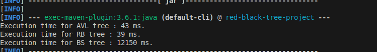
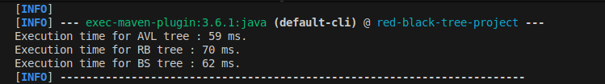
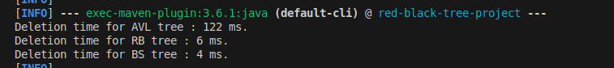
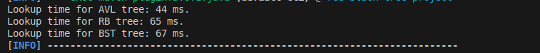

# Data Structure Comparisons

For insertion : 
To compare insertion, I created 100000 random values and compared the time it takes to insert them into each tree.

Both AVL and Red-Black trees are much faster for insertion than binary search tree, especially when the data is not shuffled, because the binary search tree will end up just chaining all the values.

<figure style="margin: 0;">
    
    <figcaption style="text-align: center;"></figcaption>
</figure>

When we shuffle the data before inserting it, all the trees end up having similar performance, so for randomly spaced data the choice of the data structure is not that important.

<figure style="margin: 0;">
    
    <figcaption style="text-align: center;"></figcaption>
</figure>

For deletion : 
To compare deletion, I inserted 100000 random values and compared the time it takes to delete them from each tree.

Red-Black trees and binary search trees are faster than AVL trees whether the data is shuffled or not. This is because AVL trees have to maintain a stricter structure, which requires more rotations to fix it after deletions.

<figure style="margin: 0;">
    
    <figcaption style="text-align: center;"></figcaption>
</figure>

For lookups :

To compare lookups, I inserted 100000 random values and compared the time it takes to look up each of them in each tree.

On average AVL tree is a bit quicker than the others, but not by much.

<figure style="margin: 0;">
    
    <figcaption style="text-align: center;"></figcaption>
</figure>

To conclude, Red-Black Tree seems to be the best structure for heavy insertion/deletion systems because it is faster at insertion than binary search tree and faster at deletion than AVL trees.
AVL tree may be better for systems where you only need to do lookups.
If a system workload can change from deletion/insertion heavy to lookup heavy, it might be interesting to start with a Red-Black tree for when we have a lot of insertions/deletions to do and then convert it to an AVL tree when we don't need any more insertions/deletions but only lookups.
